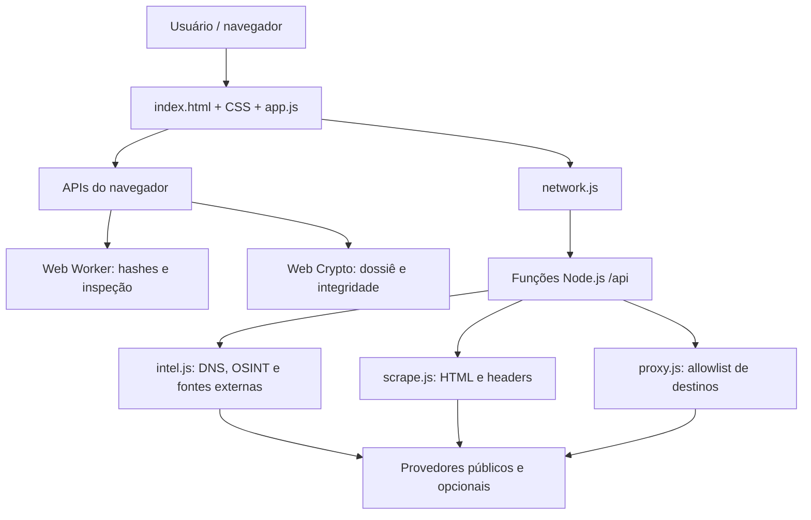

<div align="center">


### Inteligência em foco.

**Plataforma modular de investigação digital, OSINT e análise forense no navegador.**


</div>

> **Aviso:** LÚMEN auxilia a triagem e a documentação de evidências. Inferências de geolocalização, detecção de VPN, consultas OSINT e imagens ELA são indicativas; não são prova pericial conclusiva. Use a plataforma apenas com autorização e respeitando privacidade, legislação e regras dos provedores.

## Navegação

- [O projeto](#o-projeto)
- [Módulos](#módulos)
- [Arquitetura](#arquitetura)
- [Mapa do repositório](#mapa-do-repositório)
- [Executar localmente](#executar-localmente)
- [Publicar na Vercel](#publicar-na-vercel)
- [Configuração de ambiente](#configuração-de-ambiente)
- [Referência de API](#referência-de-api)
- [Segurança e custódia](#segurança-e-custódia)
- [Identidade visual](#identidade-visual)
- [Desenvolvimento e testes](#desenvolvimento-e-testes)
- [Limitações e próximos passos](#limitações-e-próximos-passos)

## O projeto

O **zFORENSE · LÚMEN** consolida **15 ferramentas em quatro áreas** numa interface responsiva, projetada para desktop e dispositivos móveis. Trabalhos de arquivos e dados sensíveis são executados, sempre que possível, no navegador. Consultas de rede dependentes de serviços externos utilizam endpoints Node.js na Vercel.

**Stack:** HTML5, CSS3 (tokens de design e Liquid Glass), JavaScript ES Modules, Web Crypto API, Web Workers, Node.js 20+ e funções serverless na Vercel. Não há framework de frontend nem etapa de transpilação obrigatória.

## Módulos

| Área | Módulo | Objetivo | Execução |
| --- | --- | --- | --- |
| Forense | VirusTotal | Consultar reputação de hash, domínio, IP e URL com fallback OTX | Servidor |
| Forense | Metadados EXIF | Analisar EXIF e GPS quando disponíveis | Navegador |
| Forense | Análise ELA | Visualizar diferenças de recompressão JPEG | Navegador |
| Forense | Custódia & Hex | Hashes, magic bytes, strings, entropia e hex dump | Web Worker |
| Forense | Decodificador | JWT, Base64, Hex, URL, ROT13, CIDR e timestamps | Navegador |
| Rede | Proxy & VPN Lab | Consultar indicadores de VPN/Proxy/Tor e listas públicas | Servidor |
| Sherlock | Sherlock OSINT | Verificar nomes de usuário em 12 serviços | Servidor |
| Sherlock | Dorks Forenses | Gerar pesquisas estruturadas | Navegador |
| Sherlock | Vazamentos | Consultar XposedOrNot e MX/SPF/DMARC | Servidor |
| Web | Subdomínios SSL | Usar transparência de certificados e fontes auxiliares | Servidor |
| Web | DNS & Segurança | Consultar registros DNS e controles de e-mail | Servidor |
| Web | Dono de Site | Consultar dados RDAP | Servidor |
| Web | Web Scraper | Inspecionar metadados HTML, contatos e headers | Servidor |
| Web | IP & Mapa | Consultar geolocalização aproximada, ISP e ASN | Servidor |
| Web | Consulta CNPJ | Validar CNPJ e consultar fontes cadastrais | Servidor |

## Arquitetura



As rotas da Vercel são necessárias para contornar limitações de CORS de **provedores externos**, manter `VT_API_KEY` exclusivamente no servidor e padronizar respostas. Não são uma VPN e não tornam a navegação anônima. O navegador isolado não executa todas as ferramentas de rede.

## Mapa do repositório

```text
zFORENSE/
├── .env.example              # Modelo de configuração, sem credenciais
├── .gitignore
├── README.md                 # Este mapa do projeto
├── package.json              # Scripts e requisitos Node
├── vercel.json               # Deploy, headers e políticas
├── index.html                # Shell da aplicação
├── api/                      # Funções serverless CommonJS
│   ├── _utils.js             # Validação, rede e respostas HTTP
│   ├── intel.js              # Integrações OSINT, DNS, CNPJ e threat intel
│   ├── proxy.js              # Proxy HTTP com allowlist
│   └── scrape.js             # Extração de metadados de páginas
├── assets/
│   ├── brand/
│   │   ├── lumen-mark.svg    # Ícone e favicon vetoriais
│   │   └── lumen-lockup.svg  # Assinatura horizontal da marca
│   ├── css/
│   │   └── styles.css        # Temas, Liquid Glass e responsividade
│   └── js/
│       ├── app.js            # Catálogo, roteamento e fluxos de UI
│       ├── network.js        # Cliente HTTP, timeout e estado da API
│       ├── ui.js             # Componentes e exportação do dossiê
│       ├── crypto-custody.js # Criptografia e selos de integridade
│       ├── worker-forensics.js # Processamento de arquivos fora da UI
│       ├── exif-parser.js    # Leitura local de EXIF e metadados
│       ├── ela.js            # Error Level Analysis visual
│       └── decoders.js       # Conversores e decodificadores
└── tests/
    └── utils.test.cjs        # Testes automatizados de utilitários
```

## Executar localmente

**Pré-requisitos:** Node.js 20+ e conta Vercel, ou Vercel CLI devidamente autenticada.

```bash
git clone https://github.com/jarodofc/zFORENSE.git
cd zFORENSE
npm install
cp .env.example .env.local
npx vercel dev
```

No Windows PowerShell, use `Copy-Item .env.example .env.local`. Abra o endereço informado pelo `vercel dev` (normalmente `http://localhost:3000`). Se você abrir somente `index.html` sem o servidor, funções de API como VirusTotal, DNS e CNPJ **não estarão disponíveis**. As operações locais de EXIF, ELA e decodificação exigem um contexto web compatível; Web Crypto geralmente exige HTTPS ou localhost.

## Publicar na Vercel

1. Importe o repositório pelo painel da Vercel.
2. Configure **Framework Preset: Other** e mantenha os comandos de build padrão sem etapas extras.
3. Cadastre `VT_API_KEY` em **Settings → Environment Variables**, se quiser usar a API v3 do VirusTotal.
4. Publique e verifique `/api/proxy?ping=1`; a resposta de sucesso inclui `ok: true`.
5. Valide as integrações na interface. Fontes externas podem sofrer bloqueios, mudanças e limites de requisições.

## Configuração de ambiente

| Variável | Necessária | Uso |
| --- | --- | --- |
| `VT_API_KEY` | Não | Credencial privada para a API v3 do VirusTotal |
| `ALLOWED_ORIGIN` | Não | Origem HTTPS explícita autorizada a ler respostas cross-origin |

Copie `.env.example` para `.env.local`. **Nunca** inclua tokens verdadeiros em arquivos versionados nem envie credenciais pela URL ou cabeçalhos do navegador. A presença prévia de um valor em `.env.example` exige **revogação e rotação no serviço emissor**, mesmo depois de removê-lo do Git: o histórico continua acessível.

Na ausência de `VT_API_KEY`, o módulo de reputação tenta o fallback público AlienVault OTX. Resultados e campos podem diferir dos oferecidos pelo VirusTotal.

## Referência de API

Todos os endpoints usam `GET` e respostas JSON, exceto `/api/proxy`, que também pode devolver conteúdo do provedor.

| Endpoint | Parâmetros | Função |
| --- | --- | --- |
| `/api/proxy?ping=1` | `ping=1` | Teste de conectividade |
| `/api/proxy` | `url` | Encaminhar GET apenas para hosts aprovados |
| `/api/scrape` | `url` | Analisar metadados e headers HTTP |
| `/api/intel` | `action=dns&domain=...` | Registros DNS |
| `/api/intel` | `action=rdap&domain=...` | Registro de domínios |
| `/api/intel` | `action=subdomains&domain=...` | Transparência de certificados |
| `/api/intel` | `action=ip&target=...` | Informações de IP |
| `/api/intel` | `action=cnpj&cnpj=...` | Consulta CNPJ |
| `/api/intel` | `action=sherlock&username=...` | Busca de usernames |
| `/api/intel` | `action=breach&email=...` | Bases de incidentes |
| `/api/intel` | `action=virustotal&type=domain&target=...` | Reputação de indicadores |
| `/api/intel` | `action=vpn_detect&target=...` | Sinais de VPN/Proxy |
| `/api/intel` | `action=vpngate` | Servidores VPN públicos |
| `/api/intel` | `action=proxies` | Fontes de proxies públicos |
| `/api/intel` | `action=reverse_geo&lat=...&lon=...` | Geocodificação reversa |

Exemplo:

```bash
curl "http://localhost:3000/api/intel?action=dns&domain=example.com"
```

A estrutura de resposta, os limites de cada provedor e a disponibilidade não são garantidos. Para novas integrações, normalize as respostas na API e só depois apresente-as em `app.js`.

## Segurança e custódia

- **Separação local/remoto:** arquivos usados em EXIF, ELA e na inspeção de hashes são processados no navegador; consultas remotas enviam os alvos informados aos provedores correspondentes.
- **SSRF:** validação de esquemas, destinos públicos e redirecionamentos reduz riscos, mas resolução DNS antecipada não substitui bloqueio de rede por IP no momento da conexão. Não trate a validação como isolamento completo contra DNS rebinding.
- **Limite de resposta:** o proxy aplica limite de tamanho ao corpo recebido.
- **Criptografia:** o dossiê local usa Web Crypto e AES-GCM quando disponível. A chave atual é associada à sessão do navegador; a recuperação após o encerramento da sessão não é garantida.
- **Exportação:** JSON contém hash SHA-256 e HMAC de sessão, que auxiliam a detectar alterações dentro do contexto da sessão. **Não equivalem a assinatura digital verificável independentemente, carimbo do tempo confiável ou cadeia de custódia jurídica.**
- **Privacidade:** dados consultados podem ser registrados localmente no histórico da interface. Evite inserir dados pessoais ou empresariais sem base legal e autorização.

## Identidade visual

A identidade **LÚMEN** une foco forense e clareza visual:

| Token | Cor | Aplicação |
| --- | --- | --- |
| Obsidiana | `#090F18` | Plano de fundo |
| Azul espectral | `#94B6FF` | Destaques e estados ativos |
| Verde fóton | `#78DFC9` | Indicação secundária |
| Branco gelo | `#EFF5FF` | Leitura principal |
| Vidro | `rgba(21,32,49,.60)` | Superfícies translúcidas |

**Tipografia:** Manrope nos títulos, DM Sans no corpo e IBM Plex Mono para artefatos técnicos. Os pictogramas da interface usam **Material Symbols Rounded** (glifos vetoriais); símbolo e assinatura de marca são arquivos SVG próprios. Temas e transparência respeitam, quando suportadas, preferências de acessibilidade e movimento reduzido.

Os nomes internos dos temas (`prism`, `ivory`, `noir`) permanecem para compatibilidade com preferências já armazenadas. Na interface, seus nomes são **Lúmen**, **Claro** e **Alto contraste**.

## Desenvolvimento e testes

```bash
npm run check    # Testes sem dependências de teste externas
npm run dev      # Usa a Vercel CLI para APIs e frontend
```

**Orientação por responsabilidade:** mantenha interface e APIs do navegador em JavaScript ES Modules, processamento intensivo em Web Workers e integrações/segredos no Node.js serverless. Adicionar outra linguagem sem uma necessidade operacional específica aumentaria custo de deploy e manutenção sem melhorar a segurança ou o desempenho por si só.

## Limitações e próximos passos

- Fontes públicas podem limitar requisições, mudar resposta ou encerrar serviços.
- ELA indica diferenças de compressão, não comprova autoria ou edição maliciosa.
- Detecção de VPN/Proxy e geolocalização por IP têm falsos positivos e incerteza.
- Proteção SSRF completa precisa de controles no nível de conexão/egress, além de checagem DNS.
- Persistência criptográfica de longo prazo e assinatura de prova verificável externamente exigem um fluxo de chaves e custódia específico.
- Endpoints públicos sem autenticação devem receber proteção antiabuso antes de uma exposição ampla.

**Licença:** este repositório não contém arquivo `LICENSE`; nenhuma licença de uso ou redistribuição deve ser presumida.

---

<div align="center"><sub>zFORENSE · LÚMEN | Inteligência em foco.</sub></div>
